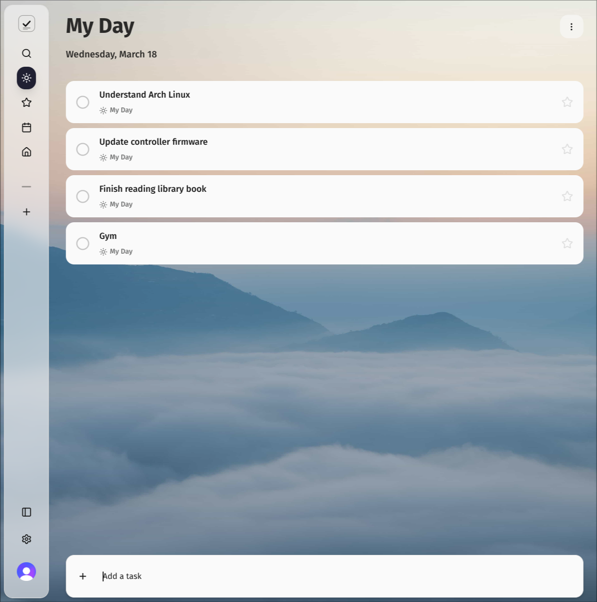

# OpenTodo

Maintained in the [OpenOak monorepo](https://github.com/open-oak/openoak/tree/main/apps/todo).
The earlier separate repository is a historical archive.

The canonical hosted app is `https://todo.openoak.org`. The branded entry
domain `https://app.opentodo.org` permanently redirects to the canonical host
while preserving the requested path and query string.

OpenTodo is a self-hostable task app inspired by Microsoft To Do, minus the Microsoft account obstacle course. It is the task app in the OpenOak ecosystem, deployed at `todo.openoak.org`.



It supports task capture, smart lists, custom lists, due dates, subtasks, notes, search, sorting, bulk actions, themes, and wallpapers. Independent installs use local accounts. Shared OpenOak authentication is optional.

## Features

- Smart lists: My Day, Important, Planned, and Tasks.
- Custom lists with drag ordering.
- Shareable custom lists with signed, revocable invite links and editor membership. Smart lists and the built-in Tasks list always stay private.
- Task details with notes, due dates, importance, My Day, and subtasks.
- Search, sorting, bulk complete, bulk move, copy, and delete.
- Import from Microsoft To Do (JSON or CSV from the open-source Microsoft To Do Export tool) or from pasted text. See [Importing tasks](#importing-tasks).
- Responsive desktop and mobile layouts.
- Themes, wallpapers, dark mode, and optional Transparent UI.
- Local accounts with Better Auth and optional shared OpenOak authentication.
- PostgreSQL persistence through Prisma.
- Page-aware collaboration sync every 15 seconds while the page is visible, with ETag/304 support and optimistic-edit protection.

## Stack

- Next.js 16, React 19, TypeScript
- Tailwind CSS 4
- Prisma 7 with PostgreSQL
- Better Auth
- Zustand
- Vitest
- Vercel-ready, not Vercel-only

## Setup

Use Node.js 22.x (22.18.0 or later), npm, and PostgreSQL 17. Keep the complete monorepo
checkout and install dependencies from its root with `npm ci`. Follow
[Self-hosting](../../docs/SELF_HOSTING.md) for the environment variables,
migrations, build and startup. Leave shared Account variables unset to use local
accounts.

## Sharing and privacy

- Only user-created `CUSTOM` lists can be shared. My Day, Important, Planned,
  and the built-in Tasks list are private per account and never accept members.
- Owners create, copy, rotate, or disable a list invite and can remove editors.
- Editors can edit tasks, rename the list, and change its theme/background.
  They cannot invite or remove people, delete the list, or transfer ownership.
- Opening an invite is read-only. A signed-in user joins only after pressing
  **Join list**, which submits an explicit POST-backed server action.
- Invite URLs contain only a compact random bearer token. They expose no list ID,
  account data, or authentication secret.
- OpenTodo polls only the visible task page. Local drafts and pending optimistic
  changes overlay incoming rows so polling does not interrupt typing.

Data export format `opentodo` version 2 exports owned lists plus the current
user's personal My Day/Important state for tasks in lists shared with them. It
does not export other users' membership, invite nonces, or private flags.

## Importing tasks

Settings > Import tasks, or open `/?import=microsoft-to-do` (the website links
here). `POST /api/import` accepts same-origin JSON up to 4 MB and writes only
into the signed-in user's own lists.

- **Microsoft To Do file:** the JSON (`--type json`) or generic CSV
  (`--type csv`) output of
  [Microsoft To Do Export](https://github.com/daylamtayari/Microsoft-To-Do-Export).
  A raw Microsoft Graph `{ "value": [...] }` list response also works.
  Lists, tasks, notes, steps, due dates, importance and completed state map
  directly. Recurrence, reminders, start dates and categories are written into
  the task notes. Attachments and the Flagged email list are skipped and
  counted in the summary.
- **Pasted text:** one task per line, indented lines are steps, `# Name`
  starts a list, `[x]` or a check mark marks a task done.
- The source default list goes into the built-in Tasks list; other lists match
  an owned list by name (case-insensitive) or are created. Due dates are stored
  at 12:00 UTC on the due day. Imported tasks keep their original creation time.
- A task that already exists in the target list with the same title (and the
  same creation time, when the source has one) is skipped, so running an
  import again is safe.
- The importer does not support Microsoft's own export format.

Parsers live in `lib/todo-import.ts` (pure, unit-tested); database writes in
`lib/todo-import-server.ts`.

## Deployment

Use this workspace from the monorepo for hosted or independent deployments.
[Self-hosting](../../docs/SELF_HOSTING.md),
[Database architecture](../../docs/DATABASE.md), and
[Release and recovery](../../docs/RELEASE.md) define the supported setup.

For the collaboration schema rollout and rollback sequence, use
[the collaboration migration guide](docs/TODO_COLLABORATION_MIGRATION.md).

## Scripts

```bash
npm run dev             # start local dev server
npm run build           # prisma generate + next build
npm run start           # start production server
npm run lint            # eslint
npm run test            # vitest
npm run migrate         # prisma migrate dev
npm run migrate:deploy  # prisma migrate deploy
npm run generate        # prisma generate
```

## Project Layout

```text
app/          Next.js routes, layouts, API routes, and server actions
components/   UI and task app components
hooks/        Client hooks
lib/          Auth, Prisma, utilities, shared types
prisma/       Schema and migrations
store/        Zustand store and selectors
tests/        Vitest tests
public/       Icons, wallpapers, service worker assets
docs/assets/  README screenshot
```

## Contributing

- Ecosystem-wide architecture, env contract, and conventions live in
  [Contributing](../../CONTRIBUTING.md) and [Database architecture](../../docs/DATABASE.md).
- Add tests for task sorting, auth boundaries, and data ownership changes.
- Do not skip ownership checks in server actions.
- Keep self-hosting viable.
- Run `npm test`, `npm run lint`, and `npm run typecheck` before opening a PR.

## License

Open Todo is licensed under the GNU Affero General Public License v3.0 or later. See [LICENSE](../../LICENSE).

You may use, study, modify, self-host, and redistribute the app under the terms of the AGPL. If you run a modified version as a network service, the AGPL requires you to make the corresponding source code available to users of that service.
